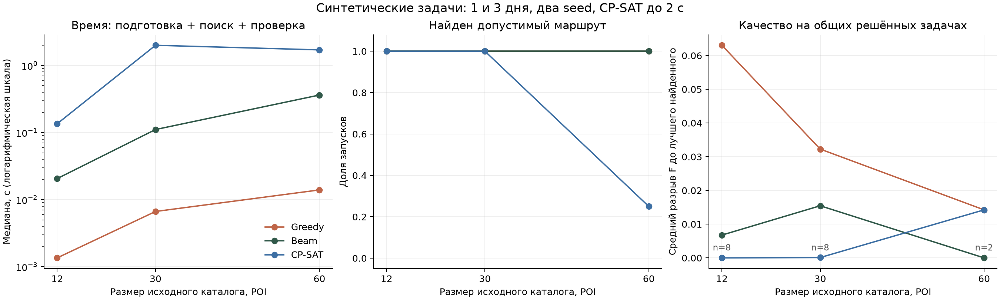

# CP-SAT и расширенные эксперименты

Ветка `feature/cp-sat-experiments` основана на `feature/shared-objective` (e5697c7).
Реализация: `backend/app/planning/cp_sat.py`, OR-Tools 9.15.6755 (версия в uv.lock).
Целевая функция прежняя: [objective-function.md](objective-function.md).

## Модель

На каждый день строится ориентированный circuit с виртуальным узлом 0. Булева
переменная посещения определяет выбор POI, петля — пропуск; петля у 0 означает
пустой день. Время начала посещений целое, в местных минутах. Активная дуга задаёт
порядок, длительность предыдущего посещения и время переезда. Положительные
длительности исключают отдельные циклы без дневного старта.

Поддерживаются 1–14 дней и до 100 уникальных кандидатов, общий бюджет, обязательные
и запрещённые POI, неполная матрица, окна работы и разные цены/категории по датам.
Один POI посещается максимум раз за поездку. Хотя бы одно посещение за период
обязательно, отдельные пустые дни разрешены. Дуга из последнего места в узел 0
виртуальная: время и цена возврата не учитываются, как и у Greedy/Beam.

После решения порядок преобразуется в раннее допустимое расписание по фактической
матрице: ожидание открытия не входит во время переездов. Каждый результат проходит
общий независимый `validate_period`, а исходная F пересчитывается через `Objective`.
Несовпадение оценки за пределами допустимой погрешности вызывает ошибку, а не
сохранение сомнительного результата.

Greedy-план передаётся как начальная подсказка, когда он допустим. Время его расчёта
входит в подготовку CP-SAT. Это не автоматический fallback: UNKNOWN возвращается
явно, даже если отдельный Greedy-план существовал. Beam также использует Greedy как
резерв, что необходимо учитывать при интерпретации сравнения методов.

Описание circuit: [официальный API OR-Tools](https://github.com/google/or-tools/blob/stable/ortools/sat/python/cp_model.py).
Статусы: [CP-SAT Solver](https://developers.google.com/optimization/cp/cp_solver/).

## Масштабирование и границы

Жёсткие ограничения заданы точно в целых минутах и евроцентах. Коэффициенты
взвешенной F округляются с масштабом M=1 000 000:

- награда каждого посещения: `round(M × α × r(c)/R_bound)`;
- стоимость: `round(M × β × group_price(c)/B)` при B>0;
- каждая входящая дуга посещения: `round(M × γ × minutes/available_minutes)`;
- для каждого активного участника: `round(M × λ × w(u,c)/Hu)`.

Последние значения суммируются по участнику. Разность их максимума и минимума
вычитается из целочисленной цели. Максимум/минимум заданы **точно** неравенствами
и выбором одного равного значения с помощью булевых селекторов. Одних неравенств
недостаточно: у промежуточного решения могли бы остаться свободные штрафы.

Округление каждого коэффициента меняет его не более чем на 0,5/M. При K посещениях
ошибка награды, стоимости и переездов вместе не превышает 1,5K/M, ошибка разности
покрытий — K/M. Поэтому для любого допустимого маршрута используется консервативная
граница `ε = 2,5 × candidate_count/M + 10⁻⁹`.
Участники с Hu=0 исключаются из штрафа точно так же, как в общем расчётчике.

`OPTIMAL` доказывает оптимум **масштабированной целочисленной цели**. Для исходной F
сохраняется `original_upper_bound = min(α + 10⁻⁹, solver_bound/M + ε)` и
`absolute_gap_bound = max(0, original_upper_bound − actual_F)`.
Даже при OPTIMAL погрешность исходного оптимума может составить до 2ε.
Дополнительные правила ничьих из `Objective.key` отдельно не оптимизируются.
CP-SAT может вернуть другой маршрут с практически равной F, чем Beam.

Для FEASIBLE сохраняются те же границы, но большой разрыв означает слабый сертификат.
Для UNKNOWN верхняя граница не берётся из неинициализированного результата решателя:
поля границ и оценки равны null. INFEASIBLE означает доказанную невозможность
по точным ограничениям принятой модели; оно не зависит от округления F.
Семантика best bound описана в [cp_model.proto](https://github.com/google/or-tools/blob/stable/ortools/sat/cp_model.proto).

## Устранённое расхождение промежуточной оценки

Первый расширенный прогон остановился на расхождении между `objective_value` и
пересчётом возвращённого решения при лимите времени. Случай 30 POI, 3 дня,
конфликтные профили, seed=17 воспроизвёл проблему. У OR-Tools описан аналогичный
[дефект presolve для lin_max](https://github.com/google/or-tools/issues/5453).
Вместо `add_max_equality`/`add_min_equality` применены явные точные селекторы.
Регрессионный тест проверяет первое допустимое решение с ранней остановкой.
После исправления основной эксперимент выполнен заново полностью; отвергнутый
прогон в сохранённые результаты не включён. Проверка согласованности не отключалась.

## API, время и интерфейс

Новый `algorithm=cp-sat` поддержан в:

```text
POST /api/v1/plans/demo
POST /api/v1/trips/{id}/routes
POST /api/v1/trips/{id}/route-sets
```

Query `time_limit_seconds=0.05..30`, по умолчанию 5. На одиночный маршрут бюджет
включает подготовку и поиск. На набор он разделяется между попытками CP-SAT,
вместо выдачи полного лимита каждой из 13 попыток. После подготовки в решатель
передаётся оставшееся время. Python-подготовка не прерывается посреди операции,
поэтому общий wall time может немного превысить бюджет; загрузка внешних данных
и БД в этот лимит не входят.

Параметр OR-Tools: [max_time_in_seconds](https://developers.google.com/optimization/cp/cp_tasks).
Один worker, seed=42, абсолютный и относительный допуск остановки по gap равны нулю.
Данные воспроизводимы, но остановка по wall time может давать разные допустимые
результаты на другом компьютере или при иной загрузке системы.

`result.solver` хранит статус, версию OR-Tools, запрошенное/оставшееся время,
фактическое время, seed, число потоков, масштаб, погрешность, model objective/bound,
границы исходной F и наличие стартовой подсказки. Поле находится в JSON результата;
новая миграция БД не нужна. Старые маршруты имеют `solver=null`.
Идентификаторы: `cp-sat-v1`, `cp-sat-period-v1`; наборы `diverse-v2:cp-sat`.
Параметр beam_width относится только к эвристикам и не меняет модель CP-SAT.

Наборы по-прежнему используют ограниченные исключения для разнообразия. Границы
решателя относятся к **конкретной поисковой попытке**, включая временные запреты,
и не доказывают оптимальность альтернативы в исходной задаче без этих запретов.
Контекст нормировки F при этом общий и не меняется.
UI показывает CP-SAT, поле лимита, статус, погрешность и границы. UNKNOWN отличается
от доказанной невозможности; исчерпание бюджета набора отмечается отдельно.
Режим Beam остаётся выбранным по умолчанию.

## Расширенный эксперимент

Основные артефакты: [отчёт](cp-sat-experiments.md), [JSON](cp-sat-experiments.json),
[CSV](cp-sat-experiments.csv), [SVG](cp-sat-experiments.svg).



Генератор `benchmark.py` версии `group-ttdp-benchmark-v1` не вызывает оптимизаторы.
Набор включает 6 прежних контрольных случаев и 24 новые конфигурации:
12/30/60 исходных POI × 1/3 дня × близкие/конфликтные интересы × seeds 17/43.
Группы содержат 2/4/6 участников; дневные окна 6/9 часов, есть бесплатные и платные
POI, частичная доступность по датам, отсутствующие дуги, обязательное и запрещённое место.
Исходный размер и фактически доступное объединение кандидатов записаны отдельно.

Каждый метод запускается трижды при одинаковых данных, Beam width=32, CP-SAT до 2 с.
Итого основной набор: 30 × 3 × 3 = 270 запусков.
Отдельно на четырёх заранее выбранных конфликтных конфигурациях 12/30 POI, 1/3 дня,
seed=17 проверены пять политик: исходная, без штрафа цены, без штрафа переездов,
без fairness и удвоенная fairness. Это ещё 4 × 5 × 3 × 3 = 180 запусков.
Всего **450**; основные и sensitivity-запуски не смешиваются при расчёте границ/качества.

Для каждого исходного экземпляра сохранены SHA-256, seed и параметры. JSON содержит
полные расписания всех попыток, фактическую F, четыре критерия, статусы/границы,
время, среду, версию OR-Tools и хеш исходников planning. Время — подготовка, поиск
и финальная валидация; без БД, сети, LLM и вывода отчёта. Все допустимые расписания
проверены повторно отдельным вызовом валидатора до записи.

Сначала F сравнивается внутри одного экземпляра и одной политики. Сырые F разных
запросов/политик не усредняются для заявления о качестве. Основная таблица качества
использует 18 общих задач с решениями у всех трёх методов и лучший результат каждого
метода среди повторов. В подробной таблице условные средние успешных запусков
сопровождаются n: при разных n выборки различаются. Regret до лучшего найденного
не равен доказанному разрыву до оптимума; отдельно приводится граница этого разрыва.

### Наблюдения

- При 2 с на основном наборе CP-SAT вернул 63 допустимых результата из 90 попыток,
  в 39 доказал оптимум целочисленной модели. Часть остальных — контрольные доказанно
  невозможные случаи, часть — UNKNOWN. Greedy/Beam дали 78/81 допустимый результат.
- На 18 общих решённых задачах средний разрыв до лучшего найденного составил
  примерно 0,04394 для Greedy, 0,00987 для Beam и 0,00163 для CP-SAT.
- На 60 POI короткий бюджет часто расходуется на подготовку и presolve.
  Это практический предел выбранного бюджета, а не доказательство невозможности.
- В sensitivity-наборе отключение штрафа цены заметно увеличило долю бюджета;
  отключение fairness увеличило разрыв покрытия. Удвоение fairness снизило его,
  но меняло полезность и состав. Это предварительная проверка влияния коэффициентов,
  не их окончательная калибровка.

Дополнительный [прогон с 10 с](cp-sat-budget-10s.md) ([JSON](cp-sat-budget-10s.json),
[CSV](cp-sat-budget-10s.csv)) содержит те же 8 крупных конфигураций 60 POI и 6 контролей,
по одному повтору: 42 запуска. CP-SAT нашёл допустимое решение во всех восьми крупных
случаях; только в одном доказал оптимум целочисленной цели. На сложных конфигурациях
Beam мог найти маршрут с большей F за меньшее время, чем ограниченный CP-SAT.
Методы не заменяют друг друга автоматически; CP-SAT полезен также как источник границ.

Два seed и небольшой набор искусственных профилей ограничивают обобщение. Измерения
локальные, без строгой изоляции фоновой нагрузки; интервалы статистической уверенности
не оценивались. Это расширенный воспроизводимый эксперимент, а не доказательство
качества на всём реальном городе. Каталог реальных POI от этого этапа не увеличивается.

## Запуск

Из `backend`, используя uv из PATH или `..\.venv\Scripts\uv.exe`:

```powershell
uv sync --locked
.\.venv\Scripts\python.exe run_experiments.py
.\.venv\Scripts\python.exe run_experiments.py --sizes 60 --seeds 17 43 --days 1 3 --repetitions 1 --time-limit 10 --skip-sensitivity --output ../docs/cp-sat-budget-10s.json
```

Быстрый прогон без перезаписи основного отчёта:

```powershell
.\.venv\Scripts\python.exe run_experiments.py --sizes 12 --seeds 17 --days 1 --repetitions 1 --time-limit 0.5 --skip-sensitivity --output ../.local/cp-smoke.json
```

Для экспорта графиков нужна отдельная группа зависимостей, не требуемая API:

```powershell
uv sync --locked --group experiments
.\.venv\Scripts\python.exe plot_experiments.py
```

После установки OR-Tools перезапустить backend. В форме выбрать «CP-SAT · OR-Tools»
и лимит. Существующие PostgreSQL/Qdrant/Redis и модели переустанавливать не нужно.

Итоговая проверка этапа: 226 тестов с PostgreSQL, Qdrant и Redis, Ruff и форматирование,
`alembic check`, `uv lock --check`, production-сборка Next.js. Для всех 492 сохранённых
попыток дополнительно проверены хеши генератора, а для каждого из 434 допустимых
маршрутов — расписание, бюджет и F повторным независимым расчётом из JSON.
В браузере проверены CP-SAT на трёх днях, лимит, сохранение вариантов и отчёта.
